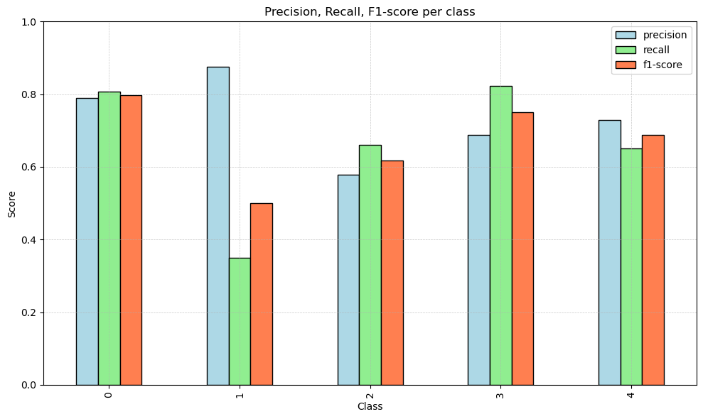

# Logistic Regression vs k-Nearest Neighbours

**A tuned comparison of a linear and a non-parametric classifier on an imbalanced five-class problem with 30 numerical features.**

Course project in machine learning, Bocconi University (2025).

<p align="center">
  
</p>
<p align="center"><sub>Per-class precision, recall and F1-score of the tuned k-NN on the test set.</sub></p>

## Pipeline

1. **Exploration.** 1,400 samples × 30 features, no missing values, five imbalanced classes; feature correlations and distributions.
2. **Preprocessing.** Standardisation inside scikit-learn pipelines, and a stratified 80/20 train–test split with a fixed seed.
3. **Baselines.** Untuned logistic regression and k-NN, evaluated with stratified 10-fold cross-validation.
4. **Tuning.** Grid search over the regularisation strength and penalty for logistic regression, and over the number of neighbours, the weighting scheme and the distance metric for k-NN, selected by weighted F1 on the training folds only.
5. **Evaluation.** Classification reports, confusion matrices, one-vs-rest ROC and precision–recall curves, and learning curves.
6. **Prediction.** The selected model labels an unlabelled test file (`predictions/predictions.txt`).

## Results

| Model | Tuned hyperparameters | CV accuracy | Test accuracy | Test macro F1 |
|---|---|---:|---:|---:|
| Logistic regression | C = 10, L2 penalty | 0.58 | 0.55 | 0.53 |
| k-NN | k = 9, distance weighting, Euclidean | 0.76 | **0.71** | **0.67** |

k-NN is selected as the final model. The rarest class (20 test samples) remains the hardest for both: tuned k-NN reaches 0.88 precision but only 0.35 recall on it. Its learning curve is still rising at the full training-set size, so more data would likely help.

## Repository structure

```
.
├── notebook/logreg_vs_knn.ipynb   Full pipeline, from exploration to final predictions
├── data/train-data.csv            1,400 labelled samples
├── data/test-data.csv             Unlabelled features for the final predictions
├── predictions/predictions.txt    Predicted labels for test-data.csv
├── assets/                        Figures used in this README
└── LICENSE
```

## Running the notebook

```bash
pip install numpy pandas matplotlib seaborn scikit-learn jupyter
cd notebook && jupyter notebook logreg_vs_knn.ipynb
```
